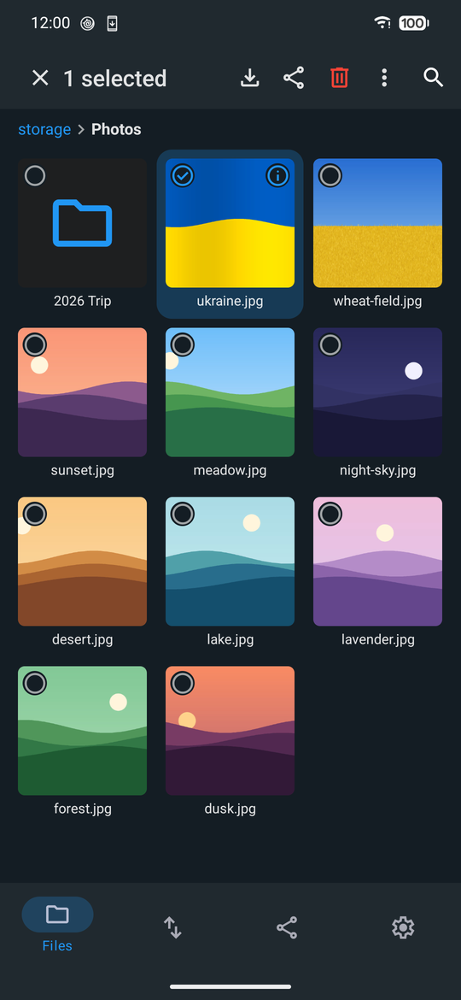
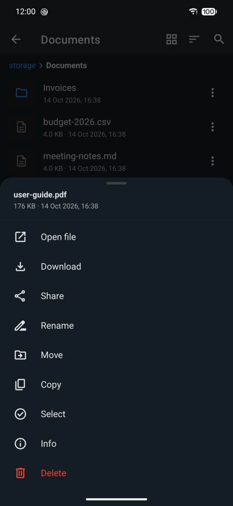
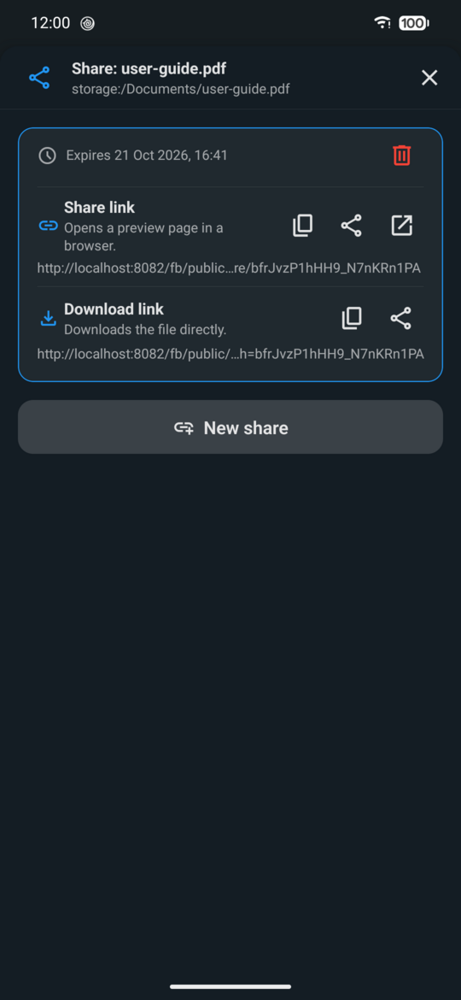
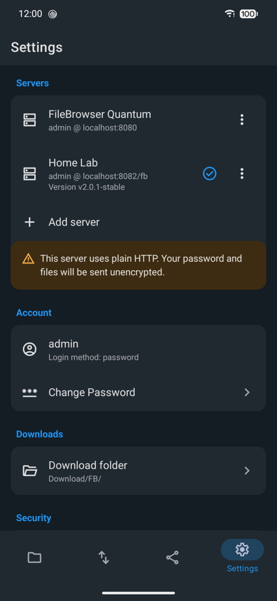

# FileBrowser Quantum for Android

An Android app for self-hosted [FileBrowser Quantum](https://github.com/gtsteffaniak/filebrowser)
servers. Browse, upload, download and share your files from your phone.

The app covers everyday file work. Server administration, user management and the other tools
stay in the web UI.

<p align="center">
  
  
  
  
</p>

## Features

- **Several servers.** Add as many servers as you like, give each one your own name and switch
  between them. Each server keeps its own sign-in.
- **Sign-in.** Password (including LDAP) and two-factor codes (TOTP). Servers that require a
  password change on first login are handled too. Servers behind a sign-in page on the reverse
  proxy (forward auth, with FileBrowser's proxy auth) open that page in the app.
- **Browse.** List or grid view, thumbnails (for PDFs too, from the first page), sort by name,
  size or date, and search.
- **Manage files.** Create folders, rename, move, copy and delete, one at a time or several at
  once.
- **Info.** Path, size, date and type for a file or folder, from its menu, from the viewer, or
  from the button on a selected grid tile. Several selected items show their total size and how
  many folders and files they are.
- **Checksums.** A file's info sheet calculates its SHA-256 on the server, to check an upload or
  download against the original.
- **Upload** from the file picker, the photo gallery, or a whole folder with its subfolders.
  Large files go up in chunks, retry after short network drops, and resume where they stopped.
- **Download** to a device folder you pick once. Folders and multiple items download as a zip.
  If the folder already has a file with that name, the new one is saved as "name (1).ext".
  Downloads retry after short network drops, and a single file resumes where it stopped.
- **View** images, video, audio and PDFs in the app. A PDF is downloaded once and kept, so it
  opens again at once until it changes on the server. Other files open in the app of your choice,
  or in the share sheet to save or send them when no app opens their type.
- **Share.** Create share links with an optional expiry and password, copy or send them, and
  manage your shares in one list. It shows the newest first, with when each link was made and
  when it expires, and flags links that expire within a day or whose item is gone.
- **Storage.** Settings shows how much each source holds and how much free space is left on its
  disk, in red with a warning once the disk is almost full. Uploads that wouldn't fit are stopped
  before they start, since the server doesn't check.
- **Transfers.** A tab with progress, speed and history for uploads and downloads, with cancel
  and retry, uploads in green and downloads in blue. Transfers keep going when you switch servers
  and when the app is in the background, with their progress in a notification.
- **Screen lock** with fingerprint, face or device PIN. It locks again after a delay you choose.
- **English and Ukrainian.** The app follows the phone's language and switches as soon as you
  change it. On Android 13 and later you can also pick the app's language on its own in
  Settings → Apps.
- **Follows the server's look.** Same names, wording and colours as the web UI, plus light and
  dark themes that follow the system.

## What it covers

The app is built on the server's own API (the Go backend), the same one the web UI uses. It
covers part of it:

| Covered by the app                                                                                                                                       | Left to the web UI                                                                                                               |
| -------------------------------------------------------------------------------------------------------------------------------------------------------- | -------------------------------------------------------------------------------------------------------------------------------- |
| Sign-in with password or LDAP, two-factor codes, required password change, sign-in pages in front of the server (proxy auth), session renewal and logout | Single sign-on (OIDC) and passkeys                                                                                               |
| Listing, creating, renaming, moving, copying and deleting files and folders                                                                              | User management, access rules and server settings                                                                                |
| Chunked uploads, single-file and zip downloads                                                                                                           | Duplicate finder, size viewer, file watcher, activity log and advanced search                                                    |
| Thumbnails, image and PDF viewer, video and audio playback                                                                                               | Built-in editors and viewers (text, Markdown, OnlyOffice, documents, EPUB, 3D). The app opens these files in another app instead |
| Share links with expiry and password, listing and deleting your shares                                                                                   | Share customisation beyond expiry and password, API tokens, notifications, pinned items                                          |
| Basic search, SHA-256 checksums, changing your own password                                                                                              | Other profile and display preferences                                                                                            |

### Why it's kept simple

The scope is narrow on purpose:

- **It fits phone use.** On a phone you mostly find a file, open it, send it or upload a photo.
  Administration and power tools are rare tasks that work better on a big screen, and the web
  UI already does them well.
- **Less can break.** Every API call the app makes is one more thing a server update can
  change. A small surface means fewer of those, and each one was checked against
  v2.0.1-stable.
- **It's easier to test and maintain.** Every feature listed here was tried on a real phone.
  A smaller app keeps that realistic.

Anything the app leaves out is still in the web UI on the same server.

### Gaps in the server it works around

Checked against the v2.0.1-stable source:

- **Free space before uploads.** The server doesn't check free space. It writes an upload until
  the disk is full and then fails it. The app checks first, counting uploads still waiting in
  the queue, and stops uploads that wouldn't fit. It also warns once less than 10% of a disk is
  free.
- **Usage that lags behind.** The server caches disk usage for 30 seconds, and its indexed
  "used" figure can trail uploads and deletes for longer, in the web UI too. The app shows the
  size of the source's root folder, which is always current, and updates free space as soon as
  its own uploads and deletes finish.
- **Interrupted large uploads.** The server keeps a partial file but locks its path to the
  upload that started it for 30 minutes, so starting over gets a conflict. The app remembers
  that upload, so retrying, even after the app was closed, picks up from the last chunk the
  server confirmed.
- **Share order and dates.** The server lists shares in a different order on almost every
  request once there are more than 8, and records no creation date. The app reads the dates from
  the activity log, which keeps 30 days by default, and sorts newest first. Older links come
  after, by expiry.
- **Share paths of scoped users.** For a user whose scope isn't `/`, the server returns share
  paths with the scope in front, so they don't match the user's own paths. The app strips it, so
  shared items are marked and "Go to item" opens the right folder.

## Requirements

- Android.
- A FileBrowser Quantum server, version 2.0.x. The app shows a warning on other versions.
- The server address, including its subpath if it has one, such as `files.example.com` or
  `example.com/files`. Without `https://` or `http://` in front, the app tries HTTPS first and
  then plain HTTP.

Plain `http://` servers work, but the app warns that your password and files travel
unencrypted. Use HTTPS for anything outside your home network.

## Privacy

The app doesn't collect any data about you. There are no analytics, no tracking, no ads and no
crash reporting.

- The app only talks to the servers you add. Nothing goes to the app's developer or any third
  party.
- Your session token is kept in Android's encrypted secure storage. Your password isn't stored.
- For a server behind a sign-in page, that page's session cookie stays in the app's private web
  storage, like in a browser.
- Server addresses and settings stay on the device. Removing a server signs you out of it and
  forgets its address and session.

## Testing

The app is tested manually with a release build on a physical Android phone, against
FileBrowser Quantum v2.0.1-stable running in Docker and a real self-hosted server over HTTPS.

## Development

You need Node.js, an Android phone with USB debugging, JDK 17 and the Android SDK with the
platform, build tools and NDK versions listed in
`node_modules/react-native/gradle/libs.versions.toml`.

```bash
npm install   # also installs the git hooks (husky)
export JAVA_HOME=/usr/lib/jvm/java-17-openjdk-amd64 ANDROID_HOME=$HOME/Android/Sdk
npm run android   # builds a development build, installs it over USB and starts Metro
```

The app also starts in [Expo Go](https://expo.dev/go), but Expo Go lacks the app's native
modules in `modules/`. There PDFs open in another app instead of the viewer, transfers pause
when the app goes to the background, and servers behind a sign-in gateway only partly work.

Checks:

```bash
npm run lint       # ESLint (eslint-config-expo) + Prettier
npm run typecheck  # tsc --noEmit
npm run format     # Prettier --write
```

The pre-commit hook runs lint-staged: `eslint --fix` and Prettier on staged files, then a
project-wide `tsc --noEmit`.

To test against a local server, run the `gtstef/filebrowser:2.0.1-stable` Docker image (see the
[upstream docs](https://github.com/gtsteffaniak/filebrowser) for configuration) and publish it on
port 8080. With the phone on USB, `adb reverse tcp:8080 tcp:8080` makes it reachable from the app
as `http://localhost:8080`.

### Release builds

Release APKs are built locally with `eas build --local`, using the same toolchain:

```bash
npx eas-cli@latest build -p android --profile preview --local
```

It runs the same steps as a cloud build and signs with the keystore kept on the project's EAS
account, so updates install over earlier releases. A fork needs its own EAS project and key.

### Project layout

```
src/app/         screens and navigation (Expo Router)
src/api/         FileBrowser Quantum API client
src/session/     servers, sign-in and preferences
src/transfers/   upload and download queue, and keeping it running in the background
src/lock/        screen lock
src/components/  shared UI, grouped by files, servers, shares and basic UI pieces
src/hooks/       file and share actions, sources, checksums, theme
src/lib/         helpers: paths and URLs, free space, PDFs, gateway cookies, dialogs, toasts
src/constants/   theme colours
src/i18n/        translations (keys match the web UI)
modules/         the app's own Android native modules: gateway cookies, PDF pages,
                 transfer service
```

## Credits

- [FileBrowser Quantum](https://github.com/gtsteffaniak/filebrowser) by gtsteffaniak. The logo
  and the interface text come from that project, which is licensed under Apache-2.0.
- This is an independent client, not affiliated with the FileBrowser Quantum project.
- I don't have deep React Native experience, so the project structure
  may not be perfect. The app has been tested and works, and suggestions are welcome.

## License

[MIT](LICENSE). The FileBrowser Quantum logo (`assets/images/`) and interface text
(`src/i18n/en.json`) keep their [Apache-2.0](LICENSE-APACHE) license.

Built with [Expo](https://expo.dev) and an AI coding agent
([Claude Code](https://claude.com/claude-code)).
